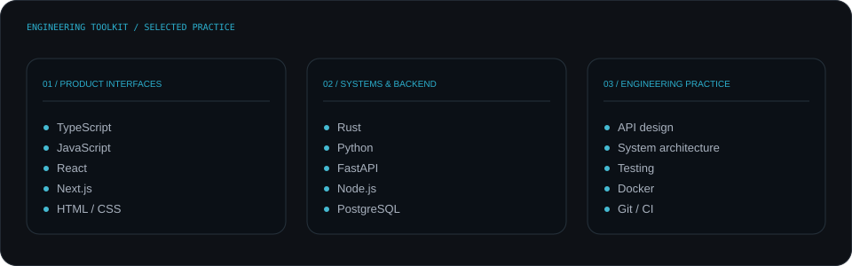

<!-- NOTLXNRD profile | Source of truth: data/profile.json + scripts/render_readme_cards.py -->

  
  

    <a href="https://leonardlomude.vercel.app">PORTFOLIO</a>
    &nbsp;·&nbsp;
    <a href="https://github.com/isthatleo?tab=repositories">EXPLORE MY CODE</a>
    &nbsp;·&nbsp;
    <a href="https://github.com/isthatleo/automatic-octo-spork/tree/main/nancy-billion">CURRENT BUILD</a>
  

---

## Engineer by craft. Builder by instinct.

I’m Leonard Lomude — a software engineer and product builder based in Kampala, Uganda, working globally.

I work across product thinking, interface design and systems engineering. My focus is building useful software end to end: understanding the problem, shaping the architecture, designing the experience and shipping something dependable.

I’m especially interested in the space where **AI, software products, business infrastructure and intelligent automation** meet.

## What I’m building toward

<table>
  <tr>
    <td width="50%" valign="top">
      <strong>01 / AI &amp; intelligent systems</strong>

      Agent orchestration, tool use, memory, multimodal interfaces and private-first assistants.
    </td>
    <td width="50%" valign="top">
      <strong>02 / Product engineering</strong>

      Full-stack applications, thoughtful interfaces, APIs, data models and production workflows.
    </td>
  </tr>
  <tr>
    <td width="50%" valign="top">
      <strong>03 / Business infrastructure</strong>

      ERP platforms, education operations, automation and connected business workflows.
    </td>
    <td width="50%" valign="top">
      <strong>04 / Trading technology</strong>

      Market tooling, trading journals, risk workflows and analytics for disciplined execution.
    </td>
  </tr>
</table>

## Selected work

A few products and systems that represent the problems I like working on.

  
    
  
    
  
    
  

## Engineering toolkit

I choose tools around the problem, not the other way around.

  

## How I approach the work

- **Architecture before accumulation.** Keep the system understandable as it grows.
- **Experience is part of the engineering.** A powerful backend still needs a clear interface.
- **Evidence over theatre.** Test the thing, measure what matters and be honest about what is unfinished.

## Open-source activity

  
    
  

---

  <strong>Have a good problem to solve?</strong> 
  <a href="https://leonardlomude.vercel.app">Explore my work and get in touch →</a>  
  NOTLXNRD · Software, systems and products built with intent. 
  Kampala, Uganda · Working globally

