  

  <a href="https://leonardlomude.vercel.app">PORTFOLIO</a> &nbsp;/&nbsp;
  <a href="https://github.com/isthatleo?tab=repositories">CODE</a> &nbsp;/&nbsp;
  <a href="https://github.com/isthatleo/automatic-octo-spork/tree/main/nancy-billion">CURRENT SYSTEM</a>

---

## THE PRACTICE

I’m Leonard Lomude — an independent software engineer working at the intersection of **AI systems, product engineering and business software**.

I build the whole chain: the problem, the architecture, the interface, the data, the deployment, and what happens when real people use the thing.

Based in Kampala, Uganda. Working globally.

**CURRENT FIXATION — making complex systems feel simple:**

- Private-first AI and agent infrastructure
- Software products with deliberate interaction design
- Reliable platforms for real operational work
- Tools that turn data into better decisions

---

## SELECTED WORK

*Four problem spaces. Four ongoing attempts to make something useful.*

---

## THE TOOLKIT

---

## ACTIVITY

---

## PRINCIPLES

- **Clarity over cleverness** — the best architecture is one a team can reason about.
- **Useful over impressive** — a product earns its complexity by solving a real problem.
- **Evidence over theatre** — test what ships, measure what matters, say what is unfinished.
- **Design is engineering** — the interface is part of the system, not decoration added later.

---

  

