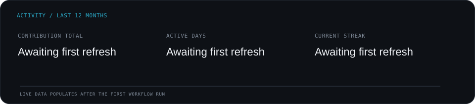

<!-- NOTLXNRD profile | Source of truth: data/profile.json + scripts/render_readme_cards.py -->

  
  

    <a href="https://leonardlomude.vercel.app">PORTFOLIO</a>
    &nbsp;·&nbsp;
    <a href="https://github.com/isthatleo?tab=repositories">REPOSITORIES</a>
    &nbsp;·&nbsp;
    <a href="https://linkedin.com/in/notlxnrd">LINKEDIN</a>
  

---

## The work

I’m Leonard — a software engineer and product builder based in Kampala, Uganda. I work across product thinking, interface design and systems engineering, turning ambitious ideas into software that can actually ship.

My interests sit at the intersection of **AI, developer tooling, business systems and intelligent automation**. I care about the whole build: the architecture underneath, the experience on top, and the details that make a product dependable.

## Current focus

<table>
  <tr>
    <td width="50%" valign="top">
      <strong>01 / AI & intelligent systems</strong> 
      Agent orchestration, tool use, memory, multimodal interfaces and private-first assistants.
    </td>
    <td width="50%" valign="top">
      <strong>02 / Product engineering</strong> 
      Full-stack applications, polished interfaces, APIs, data models and production workflows.
    </td>
  </tr>
  <tr>
    <td width="50%" valign="top">
      <strong>03 / Business infrastructure</strong> 
      ERP platforms, education operations, automation and connected business workflows.
    </td>
    <td width="50%" valign="top">
      <strong>04 / Trading technology</strong> 
      Market tooling, trading journals, risk workflows and analytics for disciplined execution.
    </td>
  </tr>
</table>

## Selected work

  
    
  
    
  
    
  

## Tools I work with

  
  
  
  
  
  
  
  
  
  

## Open source activity

  
    
  

---

  <strong>NOTLXNRD</strong> · Software, systems and products built with intent. 
  <a href="https://leonardlomude.vercel.app">leonardlomude.vercel.app</a> · Kampala, Uganda · Working globally

