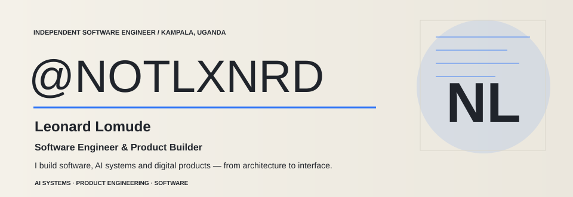
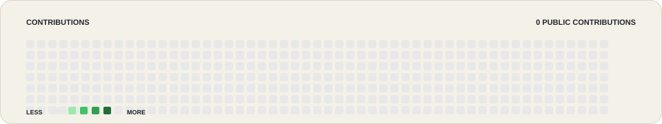
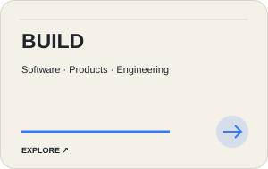
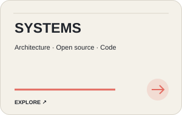
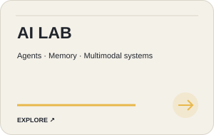
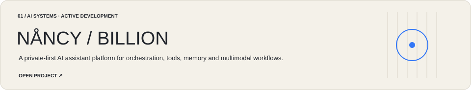
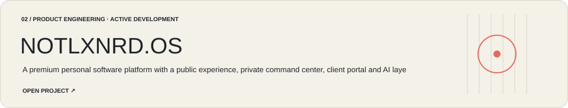
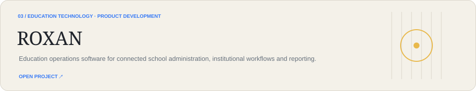
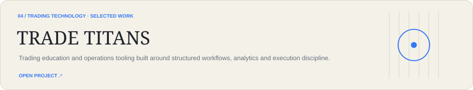

  

  <a href="https://leonardlomude.vercel.app">PORTFOLIO</a> &nbsp;·&nbsp;
  <a href="https://github.com/isthatleo?tab=repositories">GITHUB</a> &nbsp;·&nbsp;
  <a href="https://github.com/isthatleo/automatic-octo-spork/tree/main/nancy-billion">NÅNCY / BILLION</a>

  

  

  
  
  

## WHAT I'M BUILDING

I'm Leonard Lomude — an independent software engineer working across **AI systems, product engineering and business software**.

I care about the full chain: understanding the problem, shaping the architecture, building the interface, engineering the data layer and making the product reliable in the real world.

Based in Kampala, Uganda. Building for a wider world.

## SELECTED WORK

---

Software engineering · AI infrastructure · Product design · Kampala, Uganda
