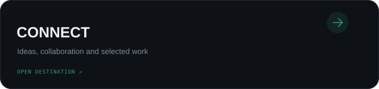

<!-- Generated SVG profile. Edit data/profile.json and rerun scripts/render_readme_cards.py. -->

  
   
  
  
  
    
  
    

## Selected work

  
    
  
    
  
    
  

  
   
  Designed and generated in-house · <a href="https://leonardlomude.vercel.app">NOTLXNRD.OS</a>

